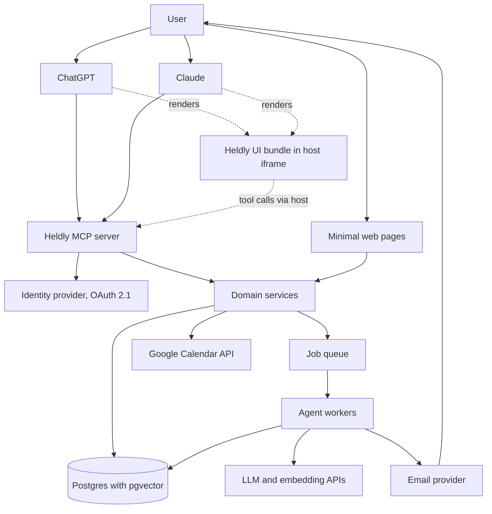
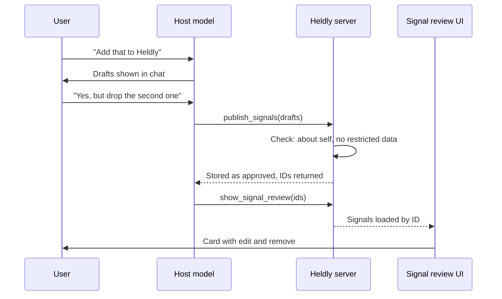
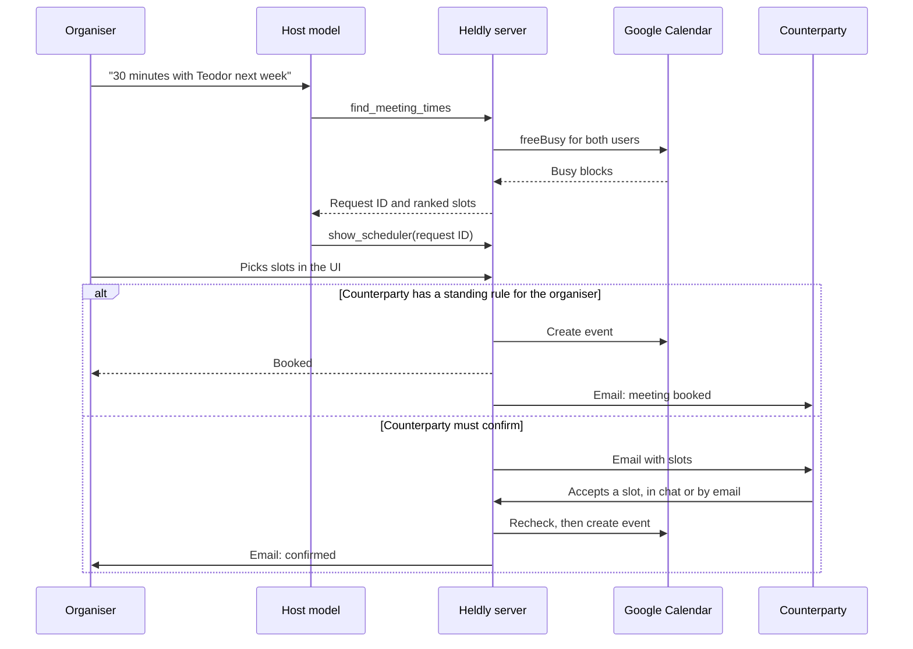
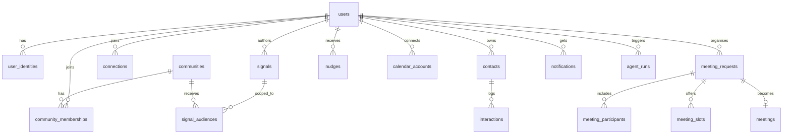

# Heldly: Product Requirements, Feasibility Study and Technical Design

| | |
| :-- | :-- |
| **Status** | Draft 1, for design and validation |
| **Date** | 2026-11-21 |
| **Inputs** | `Heldly idea memo.md` (Draft 2), the product brief (no standalone frontend; UI inside ChatGPT and Claude; agents that schedule meetings), boardy.ai as reference |
| **Platform facts** | Checked against live OpenAI, Anthropic and MCP documentation on the date above. Sources in section 14. Anything not checked is listed in section 3.5. |
| **Existing code** | A first implementation (commit `d7bb6c8`) arrived in this repository while this document was being written. Section 11 compares it with this document. |

---

## 1. Summary and verdict

**What we are building.** Heldly keeps a business user's existing relationships warm without the user doing relationship admin. It has three jobs:

1. **Context.** Each user publishes short, approved statements about what they are doing ("signals"). Their mutual connections can query them from inside their own AI: "who in my network is working on AI tools in Berlin?"
2. **Maintenance.** Heldly tracks who the user has not spoken to, spots when a contact's signal matches something the user needs, and says so.
3. **Scheduling.** Heldly's agents find a time across both calendars and book the meeting.

There is no Heldly app. The interface is the user's ChatGPT or Claude, which renders our UI inline. We run the backend: knowledge, schedules, and agents.

**Verdict: feasible, with four corrections to the plan.**

| # | Finding | Consequence |
| :-- | :-- | :-- |
| 1 | One codebase reaches both hosts. ChatGPT and Claude both accept a remote MCP server and both render UI through the open MCP Apps standard. | The core architectural bet holds. Build one MCP server and one UI bundle. |
| 2 | Passive capture ("AI detects signals during your normal conversations") is not available and not permitted. Our server only sees what the model puts into a tool call, and ChatGPT's rules forbid collecting conversation context or triggering broadly. | Capture becomes explicit and user-initiated. This is the biggest change to the memo. See 3.3. |
| 3 | "No frontend" cannot be literal. We still ship UI code (it runs in the host's iframe) and need a handful of hosted pages: sign-in, calendar consent, invite landing, email confirm, privacy policy. | Reframe as "no standalone app, no dashboard". Budget for about five minimal pages. See 3.4. |
| 4 | Reaching the user when they are not in a chat is weak. In-chat push exists on ChatGPT only in Work chats, and we could not confirm it for Claude. | Email is the dependable proactive channel for digests, meeting requests and nudges. |

**Hardest parts, in order:** the network cold start (not a technical problem), scheduling with people who are not Heldly users, asynchronous two-party confirmation, and getting the model to call our tools at the right moments.

**Recommendation.** Build a pilot for one 30 to 80 member community, installed as a custom connector on both hosts (no directory review needed). Give it single-player value from day one (private contact memory, follow-up reminders, scheduling) so it is useful before the network fills in.

**State of the repository.** The code now in this repo is a ChatGPT-only, consumer-framed "social companion" in Python: consent-gated memories, invite-code connections, reconnection suggestions. It has no network query, no scheduling and no Claude support, and its stated rule is that Heldly never contacts anyone. That rule and that framing conflict with the brief this document answers (business users, agents that book meetings, both hosts). The team needs to pick a direction; it is question 1 in section 13.2.

The requirements and design below describe the brief's product. They were drafted before the code was visible. I have changed them only where the code made a recommendation wrong: the stack (5.2), UI packaging (6.5) and the delivery plan (12).

---

## 2. Product definition

### 2.1 Problem

From the memo: most professional connections stop after one meeting. Nobody updates anyone, CRMs need upkeep nobody does, and the connection goes cold. Meanwhile people tell their AI assistant about their work every day, so the assistant knows what they are up to and their network does not.

The brief adds a second problem: even when a user knows who to talk to, arranging the meeting costs time they will not spend.

### 2.2 Target users

| Persona | Description | Primary need |
| :-- | :-- | :-- |
| **Member** (primary) | Founder, operator or investor in a professional community. Uses ChatGPT or Claude daily. Has 50 to 500 contacts worth keeping. | Know what contacts are up to, be reminded who to reach, get meetings booked. |
| **Community lead** (buyer) | Runs an accelerator, mastermind or cohort. One decision-maker. | Members help each other more. Pays the licence. |
| **Counterparty** | Someone the member wants to meet. May or may not be a Heldly user. | Low-effort way to say yes and pick a time. |

### 2.3 Positioning against Boardy

Boardy (boardy.ai) is an AI "superconnector": users message it on WhatsApp, email, ChatGPT or Claude, it interviews them, and it introduces them to people in **Boardy's** network after both sides opt in. It also books the meeting (connect Google Calendar once, or CC Boardy on a thread) and can join calls.

| | Boardy | Heldly |
| :-- | :-- | :-- |
| Whose network | Boardy's network of strangers | The user's own existing contacts |
| Core job | New introductions | Keeping existing relationships warm |
| Consent | Double opt-in per intro | Mutual connection, then per-signal approval |
| Surface | Own persona across many channels | Inside the user's own AI, no persona |
| Scheduling | Yes, by email CC and calendar connect | Yes, same end result, calendar-first |

Boardy already covers scheduling and already has ChatGPT and Claude entry points, so scheduling alone is not a differentiator. The differentiator is the consented context layer over relationships the user already has.

### 2.4 Principles

1. **The user's AI is the interface.** No app to open, no feed, no dashboard.
2. **Nothing is shared without approval.** Every signal is confirmed by its author before anyone else can see it.
3. **Mutuality is the consent model.** One-sided follows grant no access.
4. **We never see conversations.** We receive only what the user confirms into a tool call.
5. **Agents propose, people confirm.** Irreversible actions (sending invites, booking) need a human yes, unless the user has set a standing rule.
6. **Useful alone.** A member with zero connections on Heldly still gets value.

### 2.5 Scope

**In scope for the pilot:** signals, mutual graph, network query, private contact memory, follow-up reminders, weekly email digest, Google Calendar scheduling between Heldly users.

**Later:** scheduling with non-users by email, Microsoft calendars, warm intro suggestions, in-chat push events, directory listings.

**Out of scope:** a Boardy-style meeting-joining bot, a public profile or searchable directory, contact enrichment or scraping, an in-product payment flow (see 3.1, row 9).

---

## 3. Feasibility study

### 3.1 Verified platform facts

| # | Fact | Source | Why it matters |
| :-- | :-- | :-- | :-- |
| 1 | A ChatGPT plugin is a package of skills, an MCP server, and optional UI. | OpenAI plugin architecture | Our deliverable on ChatGPT is a plugin wrapping our MCP server. |
| 2 | ChatGPT implements the open MCP Apps standard. UI runs in an iframe and talks to the host over JSON-RPC on `postMessage`. Presentations: inline card, inline carousel, fullscreen, picture-in-picture. | OpenAI "Add UI to your MCP server" | Same UI bundle can target both hosts. |
| 3 | MCP Apps is supported by Claude, Claude Desktop, VS Code Copilot, Microsoft 365 Copilot, Goose and others. Claude shows it as inline cards or fullscreen. | MCP Apps overview; Claude custom connectors article | Confirms Claude as a UI host. |
| 4 | Claude custom connectors (remote MCP) work on Free, Pro, Max, Ultra, Team and Enterprise. Free is limited to one. On Team and Enterprise an owner must add the connector first. | Claude custom connectors article | A pilot can install by URL with no directory review. |
| 5 | ChatGPT lets a user add a custom MCP server by URL and create it as a plugin, subject to account and workspace policy. | OpenAI "Connect and test your plugin" | Same for ChatGPT. |
| 6 | Claude calls our server from Anthropic's cloud, on HTTPS port 443 only. ChatGPT presents an OpenAI client certificate (mTLS) and publishes egress IPs. | Claude article; OpenAI auth guide | Server must be public HTTPS. We can verify the caller is really the host. |
| 7 | Both hosts authenticate users with OAuth 2.1 authorization code plus PKCE per the MCP authorization spec. ChatGPT prefers Client ID Metadata Documents (CIMD) and still supports Dynamic Client Registration. ChatGPT cannot use API keys or client-credentials grants. | OpenAI auth guide; MCP authorization spec | We need a compliant authorization server. Use a hosted identity provider. |
| 8 | ChatGPT rules: tools must not request or reconstruct conversation history, must not collect context "just in case", and descriptions must not recommend triggering beyond explicit user intent. No behavioural profiling unless disclosed and user-controlled. | OpenAI plugin guidelines 3.3, 4.2, 4.3, 6.1, 6.4; Security and Privacy guide | Rules out passive capture. Shapes every tool schema. |
| 9 | ChatGPT plugins may not sell digital services or subscriptions, or link to checkout. Users may sign in to an existing paid account. | OpenAI plugin guidelines 5.1 | The community licence must be sold outside the plugin. A B2B contract fits. |
| 10 | Published ChatGPT plugins must work on desktop and mobile, and review needs a demo account with no sign-up step and no 2FA. | OpenAI plugin guidelines 1.2c, 1.4 | Design UI mobile-first. Plan a reviewer login path. |
| 11 | MCP Events lets a host subscribe to server events. ChatGPT supports webhook delivery only, and only in Work chats on web, desktop with Cloud selected, and dots. The extension is in Beta and requires protocol revision 2026-07-28. | OpenAI MCP Events guide; MCP Events overview | In-chat push exists but is narrow. Do not depend on it for the pilot. |
| 12 | MCP revision 2026-07-28 is stateless: no sessions, no `initialize` handshake, and a required `server/discover` method. Cross-call state travels as explicit handles in tool arguments. | MCP changelog | Build the server stateless from day one. |
| 13 | MCP Sampling (server asks the host's model to generate) is deprecated. | MCP changelog | Our agents must call an LLM API with our own key. That cost is ours. |
| 14 | OpenAI recommends separating data tools from render tools, and keeping every tool useful without UI. | OpenAI "Add UI to your MCP server" | Adopted in section 6.1. |
| 15 | Both hosts gate when tools run: Claude users toggle connectors per conversation; ChatGPT users select a plugin with `@`. | Claude article; OpenAI "Connect and test" | The user has to have Heldly switched on in the chat. It is not ambient. |

### 3.2 Feasibility and difficulty by capability

Difficulty: 1 is routine, 3 is real integration work with known answers, 5 is unsolved or depends on something outside our control.

| Capability | Feasible | Difficulty | Notes |
| :-- | :-- | :-: | :-- |
| Remote MCP server with typed tools | Yes | 2 | Official SDKs. Must handle old and new protocol revisions. |
| OAuth 2.1 for both hosts | Yes | 3 | Routine with a hosted identity provider. Building our own authorization server would be a 5; do not. |
| Inline UI on both hosts from one bundle | Yes | 3 | Standard is shared; expect per-host and mobile quirks. Needs a test matrix. |
| Signal capture, user-initiated | Yes | 2 | "Update my Heldly" then confirm. |
| Signal capture, passive or ambient | **No** | 5 | Technically impossible (we do not see the chat) and against ChatGPT policy. |
| Mutual-graph visibility | Yes | 2 | One SQL function; property-tested. |
| Natural-language network query | Yes | 2 | The host model turns the question into tool arguments. We do filtering plus vector search. |
| Private contact memory and cadence reminders | Yes | 2 | Plain CRUD plus a daily job. |
| Google Calendar connect, free/busy, booking | Yes | 3 | Second OAuth flow; Google app verification for public launch. |
| Scheduling between two Heldly users | Yes | 3 to 4 | The 4 is the asynchronous confirm. Standing booking rules bring it back to 3. |
| Scheduling with non-users by email agent | Yes, later | 5 | Inbound email parsing, threading, time zones, an LLM in a loop with strangers. Boardy's core competence. |
| Weekly digest by email | Yes | 2 | |
| In-chat proactive nudges | Partly | 4 | ChatGPT Work chats only. Claude not confirmed. |
| Matching agent (signal meets need) | Yes | 3 | Embeddings plus an LLM rerank. Quality needs evaluation data. |
| Public directory listings | Yes | 3 | Process and calendar risk, not technical. |
| Meeting-joining bot | Out of scope | 5 | |
| Reaching critical mass in a community | Unknown | 5 | The memo already says this. It is the main risk. |

### 3.3 Where the memo's assumptions need correcting

**"AI detects signals during your normal conversations."** It cannot, in the sense the memo means. An MCP server is called only when the model decides a tool fits the user's request, and receives only that tool's arguments. ChatGPT policy separately forbids pulling conversation context or encouraging broad triggering. What we can do instead:

| Capture path | How it works | Reliability |
| :-- | :-- | :-- |
| **Explicit** (P0) | User says "update my Heldly" or "share that with my network". The model drafts signals from the conversation it already has, shows them, and calls `publish_signals` only after the user confirms. | High |
| **Skill-prompted** (P1) | Our packaged skill tells the model that when Heldly is enabled and the user has just described a plan or need, it may offer once to save it. | Medium. Model-dependent; must stay within "explicit user intent". |
| **User's own instruction** (P1) | The user adds a line to their own custom instructions asking their AI to offer Heldly updates. This is the memo's V1 idea. It is the user's choice, so it is permitted. | Medium. Early adopters only. |
| **Server-side sources** (P1) | After a Heldly-booked meeting, or from calendar metadata, our agent drafts a signal and puts it in the pending queue. | High, narrow |

**"Heldly only stores approved signals."** This holds for the explicit path if we design it carefully: the model shows drafts in the chat and calls us only on confirmation, so rejected drafts never reach our server. It does not hold for server-originated drafts, which must be stored as `pending` until reviewed. The privacy copy should say: "we store signals you approved, and drafts we generated ourselves that are waiting for your review".

**"Weekly digest: approve, edit or delete."** With the explicit path there is usually nothing pending to approve. The digest's better job is a weekly brief: what changed in your network, who to reach out to, and which of your signals are going stale.

**"The only moment you leave your AI is sign-up."** Also when connecting a calendar, and when acting on an email.

**"Community pays a licence."** Fine, but the sale cannot happen in the ChatGPT plugin (3.1, row 9).

**Visibility across a community.** The memo's rule is strictly pairwise. In an 80-person cohort that is 3,160 handshakes before the network is complete. Recommendation: joining a community is a single, clearly worded consent to share community-scoped signals with its members; pairwise connection remains the rule outside a community. This needs a product decision (section 13.2, Q2). The schema supports both.

### 3.4 The web surfaces we cannot avoid

| Surface | Why it must exist | Minimum form |
| :-- | :-- | :-- |
| Sign-in and consent | OAuth runs in a browser. | Identity provider's hosted pages. |
| Calendar connect callback | Google's OAuth redirects to us. | One "connected, return to your chat" page. |
| Invite landing | A new member arrives from an email link. | One page: what Heldly is, sign up, how to add the connector to ChatGPT or Claude. |
| Email action confirm | Email scanners pre-fetch links, so a link must never act on GET. | One page with a confirm button. |
| Privacy policy, terms, support contact | Required by both directories. | Static pages. |
| In-chat UI bundle | It is still HTML, CSS and JavaScript that we write. | One bundle with four small views (section 6.5). |

### 3.5 Not verified

These should be confirmed in the Phase 0 spikes before anything depends on them.

- Whether Claude supports the MCP Events extension. The public support matrix renders its check marks as icons that did not survive retrieval.
- How MCP Apps UI behaves in the Claude and ChatGPT mobile apps.
- Anthropic's directory policy and review requirements. The FAQ now redirects to developer docs that were not retrieved.
- Google's current classification of Calendar scopes and the user cap for unverified apps. From memory: Calendar scopes are "sensitive" (verification, no third-party security audit) and unverified apps are capped at 100 users. That would be fine for the pilot.
- Whether both hosts honour app-only tool visibility (tools the UI can call but the model cannot). The field exists: the MCP Python SDK used in this repo accepts `visibility=["model", "app"]` on app tools. Whether each host enforces an app-only setting is untested. Section 8.3 relies on it and names a fallback.
- Deep links that open ChatGPT or Claude with a pre-filled prompt.
- Model behaviour: how often each host's model calls the right Heldly tool unprompted. Only measurable by testing.

---

## 4. Product requirements

Priority: **P0** is required for the pilot, **P1** follows within the pilot period, **P2** is post-pilot.

### 4.1 Core user journeys

**J1. Onboarding.** A member receives an invite email, signs up, adds Heldly to ChatGPT or Claude, and authorises it. In the chat they are asked what they are working on and what they need; they confirm their first three signals; they are offered calendar connect.

**J2. Publish.** In any chat with Heldly enabled, the user says "add that to Heldly". The model drafts one or more signals. A review card shows them with edit and remove controls. The user approves. The signals are live to their audience.

**J3. Query.** "Who do I know working on AI tools in Berlin?" The model calls search, then renders a people card. Each person shows the matching signal, when it was posted, and actions: "why this match", "schedule", "log that we spoke".

**J4. Brief.** "What's new in my network?" or the Monday email. Shows new signals from connections, matches to the user's own needs, follow-ups due, and the user's signals that are about to expire.

**J5. Schedule.** "Set up 30 minutes with Teodor next week." Heldly checks both calendars and shows three slots. The user picks one. If Teodor allows auto-booking from this user, it is booked. Otherwise Teodor gets an email and an item in his next brief, and confirms.

**J6. Keep warm.** The user says "remind me to check in with Mina every two months". When it is due, the brief says so, with Mina's latest signal as a reason to write.

### 4.2 Functional requirements

**Accounts and connections**

| ID | Requirement | Pri |
| :-- | :-- | :-: |
| A1 | Sign up by email invite; passwordless or social sign-in through the identity provider. | P0 |
| A2 | One Heldly account can be linked from both ChatGPT and Claude and sees the same data. | P0 |
| A3 | Send a connection request by email address. Accept or decline. Pending requests give no visibility. | P0 |
| A4 | Remove a connection. The other party loses access to the user's signals immediately. | P0 |
| A5 | Join a community by invite. Community scope is an explicit choice per signal. | P0 |
| A6 | Block a user. | P1 |
| A7 | Delete account. All signals, contacts, tokens and pending items are removed. | P0 |
| A8 | Export my data. | P1 |

**Signals**

| ID | Requirement | Pri |
| :-- | :-- | :-: |
| S1 | A signal is 3 to 280 characters, has a kind (working on, looking for, offering, location, event, milestone, availability), and an audience. | P0 |
| S2 | Nothing is visible to others until the author approves it. | P0 |
| S3 | Edit and delete at any time. Delete is permanent and takes effect on the next query. | P0 |
| S4 | Signals expire (default 90 days). The author is prompted to renew or drop them. | P0 |
| S5 | A signal must be about its author. Signals about third parties are rejected. | P0 |
| S6 | Signals containing restricted or special-category data (health, credentials, government IDs and similar) are blocked before publishing. | P0 |
| S7 | A new signal can replace an older one on the same subject. | P1 |
| S8 | Server-drafted signals go to a pending queue for review. | P1 |

**Network query**

| ID | Requirement | Pri |
| :-- | :-- | :-: |
| N1 | Search visible signals by free text, kind, place, community and recency. | P0 |
| N2 | A viewer sees a signal only if the visibility rule in 8.1 holds. Enforced in one place. | P0 |
| N3 | View one person: their visible signals, my private notes, our last interaction, upcoming meetings. | P0 |
| N4 | Results state when each signal was posted. Stale data is labelled. | P0 |
| N5 | Empty results explain why (no connections yet, nobody matches) and suggest the next step. | P0 |

**Relationship maintenance**

| ID | Requirement | Pri |
| :-- | :-- | :-: |
| R1 | Private contact list, including people not on Heldly. Notes are never shared. | P0 |
| R2 | Set a check-in cadence per contact. | P0 |
| R3 | Log an interaction ("had coffee with Mina yesterday"). Heldly-booked meetings are logged automatically. | P0 |
| R4 | Follow-ups due appear in the brief with a reason. | P0 |
| R5 | When a connection's new signal matches one of my needs, I am told. | P1 |
| R6 | Suggest a warm intro to a hub who knows both people. Both must accept. | P2 |

**Scheduling**

| ID | Requirement | Pri |
| :-- | :-- | :-: |
| C1 | Connect Google Calendar. Choose which calendars count as busy. | P0 |
| C2 | Set working hours, buffers, minimum notice and default meeting length. | P0 |
| C3 | Find mutual free slots between two Heldly users with calendars connected. | P0 |
| C4 | Propose slots; the counterparty accepts one or declines. | P0 |
| C5 | On confirmation, create the event on both calendars with a video link. | P0 |
| C6 | Cancel and reschedule. | P0 |
| C7 | Standing rule per contact: "this person may book me within my rules without asking". | P1 |
| C8 | Counterparty has no calendar connected: they pick from the organiser's free slots by email. | P1 |
| C9 | Counterparty is not a Heldly user: an email agent negotiates the time. | P2 |
| C10 | Microsoft 365 calendars. | P2 |
| C11 | Three or more participants. | P2 |

**Proactive delivery**

| ID | Requirement | Pri |
| :-- | :-- | :-: |
| P1 | Weekly brief by email, with per-user day and hour, and one-click unsubscribe. | P0 |
| P2 | Transactional email for connection requests and meeting requests. | P0 |
| P3 | The brief is also available on demand in chat. | P0 |
| P4 | In-chat push through MCP Events where the host supports it. | P2 |

**Community administration**

| ID | Requirement | Pri |
| :-- | :-- | :-: |
| M1 | A community lead can invite and remove members from chat. | P0 |
| M2 | A lead sees aggregate health only (members active, signals posted, meetings booked). Never content. | P1 |

### 4.3 Non-functional requirements

| Area | Requirement |
| :-- | :-- |
| Latency | Read tools p95 under 800 ms server-side. Slot search p95 under 2.5 s (bounded by Google). UI bundle under 150 KB compressed. |
| Availability | 99.5% for the pilot. |
| Statelessness | No in-memory session state. Any instance can serve any request. |
| Idempotency | Every write tool accepts an idempotency key. Booking is exactly-once. |
| Headless | Every flow completes without UI, as text, for hosts that do not render components. |
| Mobile | Every component works at 360 px width. |
| Privacy | No raw prompts in logs. No per-query behavioural logging. Coarse location only. |
| Data residency | EU region, given the memo's Berlin-centred wedge. |
| Accessibility | WCAG 2.1 AA for components: keyboard, contrast, labels. |
| Cost guard | A token and spend budget per agent run; a daily cap per user. |

### 4.4 Success metrics

Targets are hypotheses for the pilot, to be replaced by measured baselines.

| Metric | Definition | Pilot hypothesis |
| :-- | :-- | :-- |
| Activation | Invited members who publish at least 3 signals in week one | 60% |
| Freshness | Active members with a signal newer than 30 days | 50% |
| Query use | Members running at least one network query per week | 40% |
| Second meetings | Meetings booked through Heldly per active member per month | 1 |
| Tool precision | Share of Heldly-relevant prompts where the model calls the right tool | 85% |
| Retention | Members active in week 8 | 40% |

The last behavioural test of the idea is "second meetings". If queries happen but meetings do not, the product is a curiosity.

---

## 5. Architecture overview

One principle sets the cost and the shape: **in-session intelligence belongs to the host; out-of-session intelligence is ours.** When the user is chatting, the host's model does the language work (paid for by the user's subscription) and our server only answers typed tool calls. Our own LLM spend is limited to work that happens when nobody is in a chat: checking signals, matching, composing the brief, negotiating by email.



### 5.1 Components

| Component | Responsibility |
| :-- | :-- |
| **MCP server** | Stateless Streamable HTTP endpoint at `/mcp`. Verifies tokens, validates input, exposes tools, serves UI resources, implements `server/discover`. |
| **UI bundle** | One self-contained HTML bundle served as a `ui://` resource with MIME type `text/html;profile=mcp-app`. It switches between four views on a `view` field in the tool result. |
| **Skills** | `SKILL.md` files packaged in the ChatGPT plugin and offered to Claude, teaching the model the workflows. |
| **Domain services** | Signals, graph and visibility, contacts, scheduling, notifications. All authorisation lives here, not in the tools layer. |
| **Agent workers** | Queue consumers for the agents in section 7. |
| **Web pages** | The surfaces in 3.4. |
| **Identity provider** | Hosted OAuth 2.1 authorization server with CIMD and DCR support. |

### 5.2 Stack

The repository already has a working stack. Nothing in this design needs a different one, so the recommendation is to keep it and add to it.

| Layer | In the repo | To add |
| :-- | :-- | :-- |
| Language and framework | Python 3.12, FastAPI, the official MCP Python SDK with its Apps extension | Nothing. |
| Database | Postgres through SQLAlchemy 2 and Alembic; SQLite for local development and tests | The `citext`, `btree_gist` and `pgvector` extensions. These are Postgres-only; see 10.4. |
| Queue | None | A Postgres-backed task queue (for example Procrastinate), so that enqueueing is transactional with domain writes and there is no second datastore. |
| Identity | A built-in development OAuth server; in production, JWT verification against a hosted provider's JWKS | Choose the provider (OpenAI's guide names Auth0 and Stytch) and confirm it supports CIMD. OpenAI advises strongly against building this yourself. |
| UI | React and Vite, built to one self-contained HTML file | Two more views (people, slot picker). |
| LLM | An optional OpenAI call for memory extraction | Embeddings and the matcher's rerank. See 11.3 on the extraction call. |
| Email | None | A transactional provider. Inbound parsing is needed for C9. |
| Calendar | None | Google Calendar API. |
| Secrets | Environment variables | KMS envelope encryption for calendar refresh tokens and webhook secrets. These tokens are the most sensitive data we would hold. |
| Hosting | Dockerfile and docker-compose | An EU region and managed Postgres. The server is stateless, so the platform is not a constraining choice. |
| Observability | Standard logging | OpenTelemetry traces and PII redaction. MCP now documents trace-context propagation in `_meta`. |

---

## 6. MCP surface

### 6.1 Design rules

1. **Data tools and render tools are separate.** Data tools return `structuredContent` and no UI. Render tools carry `_meta.ui.resourceUri`.
2. **Render tools take IDs, not content.** The server reloads everything by ID under the caller's authorisation, so the model cannot place invented people or signals into our UI.
3. **Narrow inputs.** No free-form "context" fields. No conversation arrays. This is a ChatGPT review requirement and good practice everywhere.
4. **Every tool sets `readOnlyHint`, `destructiveHint` and `openWorldHint` explicitly.** Anything that sends an email or a calendar invite counts as an irreversible send.
5. **Every tool declares `securitySchemes` with OAuth scopes.**
6. **Each operation is its own tool.** A generic "execute" tool is not allowed in the ChatGPT directory.
7. **Responses contain what the request needs and no more.** Opaque IDs are returned only where a follow-up call needs them.

Tool names below are written without a prefix for readability. The repo prefixes every tool with `heldly_`; new tools should follow that.

### 6.2 OAuth scopes

`profile`, `signals:read`, `signals:write`, `network:read`, `network:write`, `contacts:read`, `contacts:write`, `calendar:read`, `calendar:write`, `community:admin`.

Start with `profile signals:read network:read` and step up when a write tool is first used.

### 6.3 Data tools

Hints are shown as read-only / destructive / open-world.

| Tool | Purpose | R / D / O | Pri |
| :-- | :-- | :-: | :-: |
| `get_profile` | Current user. Carries `_meta["openai/profile"]` so ChatGPT can label the account. | T / F / F | P0 |
| `publish_signals` | Store signals the user has just confirmed. Runs the checks in S5 and S6. | F / F / F | P0 |
| `list_my_signals` | My signals with status and expiry. | T / F / F | P0 |
| `update_signal` | Edit text, audience or expiry. | F / F / F | P0 |
| `delete_signal` | Permanent delete. | F / T / F | P0 |
| `list_pending_signals` | Server-drafted signals awaiting review. | T / F / F | P1 |
| `review_signals` | Approve or reject pending signals. | F / F / F | P1 |
| `search_network` | Query visible signals. Inputs: `query`, `kinds`, `place`, `community`, `since`, `limit`. | T / F / F | P0 |
| `get_person` | One person's visible signals plus my private context. | T / F / F | P0 |
| `list_connections` | Mutual connections and pending requests in both directions. | T / F / F | P0 |
| `invite_connection` | Send a connection request by email. | F / T / T | P0 |
| `respond_to_connection` | Accept or decline. | F / F / F | P0 |
| `remove_connection` | Disconnect. | F / T / F | P0 |
| `save_contact` | Create or update a private contact, with cadence and notes. | F / F / F | P0 |
| `log_interaction` | Record that we spoke or met. | F / F / F | P0 |
| `get_brief` | New signals, matches, follow-ups due, expiring signals. | T / F / F | P0 |
| `resolve_nudge` | Mark a follow-up done or dismissed. | F / F / F | P0 |
| `get_calendar_status` | Whether a calendar is connected; returns the connect link if not. | T / F / F | P0 |
| `set_availability` | Working hours, buffers, notice, defaults. | F / F / F | P0 |
| `find_meeting_times` | Ranked mutual free slots. Creates a draft request and returns its ID. | F / F / F | P0 |
| `propose_meeting` | Send the chosen slots to the counterparty, or book directly under a standing rule. | F / T / T | P0 |
| `respond_to_meeting` | Accept a slot, decline, or ask for other times. | F / T / T | P0 |
| `list_meetings` | Upcoming meetings and open requests. | T / F / F | P0 |
| `cancel_meeting` | Cancel and notify. | F / T / T | P0 |
| `manage_community_members` | Invite or remove members (leads only). | F / T / T | P0 |

### 6.4 Render tools

| Tool | Component | Presentation |
| :-- | :-- | :-- |
| `show_signal_review` | Signal review | Inline card |
| `show_people` | People results | Inline carousel, or fullscreen for long lists |
| `show_scheduler` | Slot picker | Inline card |
| `show_brief` | Weekly brief | Fullscreen |

### 6.5 UI components

| Component | Contents | Actions (tool calls made from the UI) |
| :-- | :-- | :-- |
| **Signal review** | Draft or pending signals with kind, audience and expiry. | Edit, remove, approve. |
| **People results** | Person, matching signal, age of signal, last contact. | Open person, start scheduling, log interaction. |
| **Slot picker** | Three to five slots in the viewer's time zone, the other party's zone shown beside it. | Pick slot, ask for more, change duration. |
| **Brief** | Sections: new in your network, matches, follow-ups due, your expiring signals. | Renew or drop a signal, resolve a nudge, schedule. |

State rules, following OpenAI's guidance: the server is the source of truth; the component keeps only presentation state; selections the model should know about are sent with `ui/update-model-context`; nothing important goes in `localStorage`.

The repo ships one bundle at `ui://heldly/app-v1.html` and selects the view from the tool result. That is simpler than one resource per component and should be kept. A breaking change publishes a new URI (`app-v2`), because hosts cache the template. The content security policy lists only the origins the bundle needs; today that is none.

### 6.6 Skills

| Skill | Triggers when | Teaches the model |
| :-- | :-- | :-- |
| `heldly-update` | The user asks to share or save something to their network. | Draft at most three signals about the user only; show them; call `publish_signals` only after a yes; never include third-party or sensitive details. |
| `heldly-find` | The user asks who they know. | Call `search_network`, reason over the results, then `show_people` with the filtered IDs. |
| `heldly-schedule` | The user asks to set up a meeting. | Check calendar status, find times, render the picker, never claim a meeting is booked until the tool says so. |
| `heldly-brief` | The user asks what is new or who to reach out to. | Call `get_brief`, then `show_brief`. |

Skill descriptions must describe real triggers and must not ask the model to prefer Heldly over other tools.

### 6.7 Events (P2)

Advertised through `events/list`, delivered by signed webhook. Payloads carry identifiers and a one-line summary only; the host fetches detail with a read tool.

| Event | Fires when |
| :-- | :-- |
| `connection.requested` | Someone asks to connect with the user. |
| `meeting.requested` | The user is asked to confirm a meeting. |
| `meeting.confirmed` | A meeting the user proposed is booked. |
| `signal.matched` | A connection's new signal matches one of the user's needs. |
| `followup.due` | A contact's check-in date arrives. |

---

## 7. Backend agents

Each agent is a queue worker with a narrow job, a fixed tool set, a spend budget, and a row in `agent_runs`. None of them can publish a signal or book a meeting without the gates in section 8.3.

| Agent | Trigger | Job | LLM use | Pri |
| :-- | :-- | :-- | :-- | :-: |
| **Signal checker** | `publish_signals` (inline, synchronous) | Classify kind, extract place and dates, reject third-party and restricted content, embed. | Small fast model, structured output | P0 |
| **Scheduler** | `find_meeting_times`, responses, expiries | Compute slots, hold them, book, handle declines and expiry. | None. Deterministic code. | P0 |
| **Brief composer** | Weekly cron per user | Assemble the brief from visible data and send it. | Optional, for the summary line | P0 |
| **Follow-up** | Daily cron | Create nudges for cadence due and for expiring signals. | None | P0 |
| **Matcher** | A signal is approved | Find viewers whose open needs it answers; create nudges. | Embedding recall, LLM rerank | P1 |
| **Email negotiator** | Inbound email on a meeting thread | Read replies from non-users, propose and confirm times. | Mid-size model in a bounded loop | P2 |

The Scheduler deliberately contains no LLM. Slot arithmetic done by a language model produces confident mistakes about time zones and daylight saving. The model's role in scheduling is limited to turning "sometime next week, mornings" into a typed window, and the host model already does that.

### 7.1 Slot finding

1. Load both users' availability rules and selected calendars.
2. Call Google `freeBusy` for each user over the window. Busy blocks are used in memory and not stored.
3. Subtract busy blocks, buffers, minimum notice, daily caps and active holds from each user's working hours.
4. Intersect. Rank by: inside both users' preferred hours, earlier is better, spread across days.
5. Insert the top slots and a short-lived hold for each. A database exclusion constraint prevents two requests holding overlapping time for the same user.

### 7.2 Booking

1. On confirmation, re-check `freeBusy` for the chosen slot. If it is gone, mark it stale and return fresh options.
2. In one transaction: mark the request confirmed, insert the `meetings` row with an idempotency key, release the other holds.
3. Create the event through the organiser's calendar with the counterparty as attendee and a video link. Store the provider event ID.
4. If the provider call fails, the job retries with the same idempotency key. After the retry limit the request is marked failed and both parties are told.
5. Log an interaction for both sides and reset their follow-up dates.

---

## 8. Security, privacy and trust

### 8.1 Visibility rule

A viewer V can see signal S authored by A if and only if all of these hold:

- S is approved and not expired.
- V is not A, and neither has blocked the other.
- Either S is shared with connections and V and A are mutual connections, or S is scoped to a community in which both V and A are active members.

This lives in one SQL function, `visible_signals(viewer)`. Every read path goes through it. It is covered by property tests built from the memo's example graph: A and B mutual, A and C mutual, B to C pending. A sees B and C, B sees A only, C sees A only.

The memo writes the pending edge as "B → A", which contradicts "A ↔ B (mutual)" on the line above it. The outcomes it lists only follow if the pending edge is B → C, so that is what the tests use. Worth correcting in the memo.

### 8.2 Authentication

- OAuth 2.1 authorization code with PKCE (S256), `resource` parameter echoed into the token audience, `iss` returned on every authorization response.
- Publish `/.well-known/oauth-protected-resource`. On a missing or bad token, return 401 with a `WWW-Authenticate` challenge. For ChatGPT, tool-level errors also carry `_meta["mcp/www_authenticate"]`.
- Support CIMD first, DCR as fallback (DCR is deprecated in the MCP spec but both hosts still use it in places).
- Allowlist both hosts' redirect URIs: Claude's `https://claude.ai/api/mcp/auth_callback` and the ChatGPT URI shown in the plugin's management page.
- Verify signature, issuer, audience, expiry and scopes on every request.
- Optionally validate ChatGPT's client certificate and Anthropic's IP ranges at the edge.
- Google Calendar is a separate OAuth grant. Refresh tokens are envelope-encrypted; access tokens are never stored.

### 8.3 Gates on irreversible actions

Claude's Research mode can call tools without per-call approval, and any model can be steered by injected text in a tool result. So consent cannot rest on the model alone.

| Action | Gate |
| :-- | :-- |
| Publishing a signal | The checker runs server-side regardless of what the model claims. In the UI, approval is a button press that calls an app-only tool. Headless fallback: `publish_signals` with host confirmation. |
| Sending an invite or meeting proposal | `destructiveHint: true` so hosts prompt. Rate-limited per user per day. |
| Booking | Requires either the counterparty's recorded acceptance or their standing rule. Checked server-side. |
| Deleting | `destructiveHint: true`. |

All text that came from another user (signal bodies, names, meeting titles) is returned as data in `structuredContent`, never interpolated into instructions, and length-capped.

### 8.4 Data we hold

| Data | Stored | Notes |
| :-- | :-- | :-- |
| Conversations | Never | We receive tool arguments only. |
| Rejected drafts from chat | Never | They do not reach us. This is the design in 9.1. The code in the repo does it differently and does receive them; see 11.3. |
| Approved signals | Yes | Hard-deleted on request. |
| Server-drafted pending signals | Yes, until reviewed or 14 days | |
| Connection graph, communities | Yes | |
| Private contacts and notes | Yes | Third-party personal data. Minimal fields; no enrichment. |
| Calendar tokens | Yes, encrypted | Revoked at Google on disconnect. |
| Calendar event contents | No | Free/busy only, read live. |
| Meetings booked by Heldly | Yes | Time, participants, provider event ID. |
| Embeddings of approved signals | Yes | Deleted with the signal. The embedding provider is a sub-processor. |
| Query text | No | Counters only. |

### 8.5 Compliance

- **GDPR.** EU hosting, a data processing agreement with each community, a sub-processor list, deletion and export on request. The private contact list makes users (or their communities) controllers of third-party data, which needs legal review before launch.
- **OpenAI directory.** Privacy policy covering categories, purposes, recipients, retention and controls. Demo account without sign-up or 2FA. No restricted data. No subscription upsell in the plugin.
- **Google.** OAuth app verification before exceeding the test-user cap. Limited Use policy applies to calendar data.
- **Email.** One-click unsubscribe on non-transactional mail; SPF, DKIM and DMARC.

---

## 9. Key flows

### 9.1 Publishing a signal



Rejected drafts never leave the host. If the checker refuses a signal, the tool returns the reason and the model relays it.

### 9.2 Scheduling between two members



---

## 10. Database schema

PostgreSQL 16 or later. Conventions: UUID keys, `timestamptz` everywhere, enumerations as `text` with `CHECK` (simpler to migrate than enum types), hard deletes that cascade from `users`.

This is the target schema for the brief's product, written as a fresh design. The repo already has an Alembic migration with 14 tables. Section 11.4 maps one to the other and says which existing tables should stay as they are.

### 10.1 Entity overview



### 10.2 DDL

```sql
create extension if not exists citext;
create extension if not exists btree_gist;
create extension if not exists vector;

-- ============ Identity ============

create table users (
  id                uuid primary key default gen_random_uuid(),
  email             citext not null unique,
  email_verified_at timestamptz,
  display_name      text not null check (char_length(display_name) between 1 and 120),
  headline          text check (char_length(headline) <= 160),
  home_city         text,                       -- coarse, user-entered
  timezone          text not null default 'UTC', -- IANA name
  locale            text not null default 'en',
  status            text not null default 'active'
                      check (status in ('active', 'suspended')),
  created_at        timestamptz not null default now(),
  updated_at        timestamptz not null default now()
);

-- Subject issued by the identity provider. One user may have several.
create table user_identities (
  id         uuid primary key default gen_random_uuid(),
  user_id    uuid not null references users(id) on delete cascade,
  issuer     text not null,
  subject    text not null,
  created_at timestamptz not null default now(),
  unique (issuer, subject)
);
create index user_identities_user_idx on user_identities (user_id);

-- ============ Communities ============

create table communities (
  id         uuid primary key default gen_random_uuid(),
  slug       citext not null unique,
  name       text not null,
  plan       text not null default 'pilot' check (plan in ('pilot', 'paid', 'suspended')),
  seat_limit integer check (seat_limit > 0),
  created_at timestamptz not null default now()
);

create table community_memberships (
  community_id uuid not null references communities(id) on delete cascade,
  user_id      uuid not null references users(id) on delete cascade,
  role         text not null default 'member' check (role in ('owner', 'admin', 'member')),
  status       text not null default 'active' check (status in ('active', 'removed')),
  joined_at    timestamptz not null default now(),
  primary key (community_id, user_id)
);
create index community_memberships_user_idx on community_memberships (user_id) where status = 'active';

-- Email invites, for joining a community or for a connection request to a non-user.
create table invites (
  id           uuid primary key default gen_random_uuid(),
  kind         text not null check (kind in ('community', 'connection')),
  community_id uuid references communities(id) on delete cascade,
  inviter_id   uuid not null references users(id) on delete cascade,
  email        citext not null,
  token_hash   bytea not null unique,           -- SHA-256 of the emailed token
  expires_at   timestamptz not null,
  accepted_by  uuid references users(id) on delete set null,
  accepted_at  timestamptz,
  created_at   timestamptz not null default now(),
  check ((kind = 'community') = (community_id is not null))
);
create index invites_email_idx on invites (email) where accepted_at is null;

-- ============ Graph ============

-- One row per unordered pair. "Mutual" is the only status that grants visibility.
create table connections (
  id           uuid primary key default gen_random_uuid(),
  user_low     uuid not null references users(id) on delete cascade,
  user_high    uuid not null references users(id) on delete cascade,
  requested_by uuid not null references users(id) on delete cascade,
  status       text not null check (status in ('pending', 'mutual', 'declined', 'removed', 'blocked')),
  blocked_by   uuid references users(id) on delete cascade,
  created_at   timestamptz not null default now(),
  responded_at timestamptz,
  check (user_low < user_high),
  check (requested_by in (user_low, user_high)),
  check ((status = 'blocked') = (blocked_by is not null)),
  unique (user_low, user_high)
);
create index connections_high_idx on connections (user_high, status);
create index connections_low_idx  on connections (user_low, status);

-- Private address book. Rows may point at a Heldly user or at someone outside it.
create table contacts (
  id                  uuid primary key default gen_random_uuid(),
  owner_id            uuid not null references users(id) on delete cascade,
  linked_user_id      uuid references users(id) on delete set null,
  display_name        text not null check (char_length(display_name) between 1 and 120),
  email               citext,
  company             text,
  role_title          text,
  how_we_met          text check (char_length(how_we_met) <= 500),
  private_notes       text check (char_length(private_notes) <= 4000),  -- never shared
  cadence_days        integer check (cadence_days between 1 and 730),
  importance          smallint not null default 2 check (importance between 1 and 3),
  booking_policy      text not null default 'ask' check (booking_policy in ('ask', 'auto_within_rules')),
  last_interaction_at timestamptz,
  next_touch_due_at   timestamptz,
  status              text not null default 'active' check (status in ('active', 'archived')),
  created_at          timestamptz not null default now(),
  updated_at          timestamptz not null default now(),
  check (owner_id <> linked_user_id)
);
create unique index contacts_owner_email_idx  on contacts (owner_id, email) where email is not null;
create unique index contacts_owner_linked_idx on contacts (owner_id, linked_user_id) where linked_user_id is not null;
create index contacts_due_idx on contacts (next_touch_due_at) where status = 'active' and next_touch_due_at is not null;

-- ============ Signals ============

create table signals (
  id                     uuid primary key default gen_random_uuid(),
  user_id                uuid not null references users(id) on delete cascade,
  kind                   text not null check (kind in
                           ('working_on', 'looking_for', 'offering', 'location',
                            'event', 'milestone', 'availability', 'other')),
  body                   text not null check (char_length(body) between 3 and 280),
  facets                 jsonb not null default '{}',  -- {"topics":[],"place":{"city":"","country":""},"from":"","to":""}
  status                 text not null check (status in ('pending', 'approved', 'archived')),
  share_with_connections boolean not null default true,
  origin                 text not null check (origin in ('chat', 'manual', 'calendar', 'meeting', 'agent')),
  origin_client          text check (origin_client in ('chatgpt', 'claude', 'other')),
  supersedes_id          uuid references signals(id) on delete set null,
  approved_at            timestamptz,
  expires_at             timestamptz,
  embedding              vector(1024),          -- dimension is fixed by the chosen embedding model
  search_tsv             tsvector generated always as (to_tsvector('simple'::regconfig, body)) stored,
  created_at             timestamptz not null default now(),
  updated_at             timestamptz not null default now(),
  check (status = 'pending' or approved_at is not null)
);
create index signals_user_idx   on signals (user_id, status);
create index signals_tsv_idx    on signals using gin (search_tsv);
create index signals_facets_idx on signals using gin (facets jsonb_path_ops);
create index signals_expiry_idx on signals (expires_at) where status = 'approved';
-- No vector index yet: visibility filtering leaves a few thousand candidate rows at
-- most, so an exact scan is faster and exact. Add HNSW when that stops being true.

-- Community scoping. No rows means the signal is shared with connections only.
create table signal_audiences (
  signal_id    uuid not null references signals(id) on delete cascade,
  community_id uuid not null references communities(id) on delete cascade,
  primary key (signal_id, community_id)
);
create index signal_audiences_community_idx on signal_audiences (community_id);

-- ============ Calendars ============

create table calendar_accounts (
  id                       uuid primary key default gen_random_uuid(),
  user_id                  uuid not null references users(id) on delete cascade,
  provider                 text not null check (provider in ('google', 'microsoft')),
  account_email            citext not null,
  scopes                   text[] not null,
  refresh_token_ciphertext bytea not null,       -- envelope-encrypted
  token_key_id             text not null,        -- KMS key reference
  status                   text not null default 'active' check (status in ('active', 'revoked', 'error')),
  last_error               text,
  connected_at             timestamptz not null default now(),
  revoked_at               timestamptz,
  unique (user_id, provider, account_email)
);

create table calendar_selections (
  calendar_account_id  uuid not null references calendar_accounts(id) on delete cascade,
  provider_calendar_id text not null,
  counts_as_busy       boolean not null default true,
  is_booking_target    boolean not null default false,
  primary key (calendar_account_id, provider_calendar_id)
);
create unique index calendar_selections_target_idx
  on calendar_selections (calendar_account_id) where is_booking_target;

create table availability_rules (
  user_id                  uuid primary key references users(id) on delete cascade,
  weekly_hours             jsonb not null default
    '{"mon":[["09:00","17:30"]],"tue":[["09:00","17:30"]],"wed":[["09:00","17:30"]],"thu":[["09:00","17:30"]],"fri":[["09:00","17:30"]]}',
  buffer_minutes           integer not null default 10  check (buffer_minutes between 0 and 120),
  min_notice_minutes       integer not null default 240 check (min_notice_minutes >= 0),
  max_meetings_per_day     integer check (max_meetings_per_day > 0),
  default_duration_minutes integer not null default 30 check (default_duration_minutes between 10 and 240),
  default_location_kind    text not null default 'google_meet'
                             check (default_location_kind in ('google_meet', 'phone', 'in_person', 'custom')),
  updated_at               timestamptz not null default now()
);

-- ============ Introductions (P2) ============

create table intros (
  id           uuid primary key default gen_random_uuid(),
  requested_by uuid not null references users(id) on delete cascade,
  party_a      uuid not null references users(id) on delete cascade,
  party_b      uuid not null references users(id) on delete cascade,
  rationale    text not null check (char_length(rationale) <= 500),
  suggested_by text not null check (suggested_by in ('user', 'agent')),
  a_response   text not null default 'pending' check (a_response in ('pending', 'accepted', 'declined')),
  b_response   text not null default 'pending' check (b_response in ('pending', 'accepted', 'declined')),
  status       text not null default 'pending'
                 check (status in ('pending', 'accepted', 'declined', 'expired', 'completed')),
  expires_at   timestamptz not null,
  created_at   timestamptz not null default now(),
  updated_at   timestamptz not null default now(),
  check (party_a <> party_b)
);

-- ============ Scheduling ============

create table meeting_requests (
  id               uuid primary key default gen_random_uuid(),
  organizer_id     uuid not null references users(id) on delete cascade,
  intro_id         uuid references intros(id) on delete set null,
  title            text not null check (char_length(title) between 1 and 200),
  purpose          text check (char_length(purpose) <= 500),
  duration_minutes integer not null check (duration_minutes between 10 and 240),
  window_start     timestamptz not null,
  window_end       timestamptz not null,
  location_kind    text not null check (location_kind in ('google_meet', 'phone', 'in_person', 'custom')),
  location_detail  text,
  status           text not null default 'draft'
                     check (status in ('draft', 'proposed', 'confirmed', 'cancelled', 'expired', 'failed')),
  created_via      text not null check (created_via in ('chatgpt', 'claude', 'agent')),
  expires_at       timestamptz not null,
  created_at       timestamptz not null default now(),
  updated_at       timestamptz not null default now(),
  check (window_end > window_start)
);
create index meeting_requests_organizer_idx on meeting_requests (organizer_id, status);
create index meeting_requests_expiry_idx on meeting_requests (expires_at) where status in ('draft', 'proposed');

create table meeting_participants (
  id                  uuid primary key default gen_random_uuid(),
  request_id          uuid not null references meeting_requests(id) on delete cascade,
  user_id             uuid references users(id) on delete cascade,
  contact_id          uuid references contacts(id) on delete set null,
  email               citext,
  role                text not null check (role in ('organizer', 'required', 'optional')),
  response            text not null default 'pending'
                        check (response in ('pending', 'accepted', 'declined', 'wants_other_times')),
  responded_at        timestamptz,
  response_token_hash bytea unique,              -- for replies by email link
  check (user_id is not null or email is not null),
  unique (request_id, user_id)
);
create unique index meeting_participants_email_idx
  on meeting_participants (request_id, email) where email is not null;
create index meeting_participants_user_idx on meeting_participants (user_id, response);

create table meeting_slots (
  id         uuid primary key default gen_random_uuid(),
  request_id uuid not null references meeting_requests(id) on delete cascade,
  starts_at  timestamptz not null,
  ends_at    timestamptz not null,
  rank       smallint not null,
  status     text not null default 'offered' check (status in ('offered', 'selected', 'rejected', 'stale')),
  check (ends_at > starts_at),
  unique (request_id, starts_at)
);

create table meeting_slot_votes (
  slot_id        uuid not null references meeting_slots(id) on delete cascade,
  participant_id uuid not null references meeting_participants(id) on delete cascade,
  vote           text not null check (vote in ('yes', 'no')),
  voted_at       timestamptz not null default now(),
  primary key (slot_id, participant_id)
);

-- Short-lived reservation of offered time. The exclusion constraint stops two
-- requests from holding overlapping time for the same user. Expired rows are
-- deleted by the scheduler before it inserts new ones, in the same transaction.
create table slot_holds (
  id         uuid primary key default gen_random_uuid(),
  user_id    uuid not null references users(id) on delete cascade,
  request_id uuid not null references meeting_requests(id) on delete cascade,
  during     tstzrange not null,
  expires_at timestamptz not null,
  exclude using gist (user_id with =, during with &&)
);
create index slot_holds_expiry_idx on slot_holds (expires_at);

create table meetings (
  id                   uuid primary key default gen_random_uuid(),
  request_id           uuid not null unique references meeting_requests(id) on delete cascade,
  starts_at            timestamptz not null,
  ends_at              timestamptz not null,
  provider             text check (provider in ('google', 'microsoft')),
  calendar_account_id  uuid references calendar_accounts(id) on delete set null,
  provider_calendar_id text,
  provider_event_id    text,
  conference_url       text,
  status               text not null default 'scheduling'
                         check (status in ('scheduling', 'scheduled', 'cancelled', 'completed', 'failed')),
  idempotency_key      text not null unique,
  created_at           timestamptz not null default now(),
  updated_at           timestamptz not null default now(),
  check (ends_at > starts_at),
  unique (provider, provider_event_id)
);
create index meetings_time_idx on meetings (starts_at) where status = 'scheduled';

-- ============ Relationship maintenance ============

create table interactions (
  id          uuid primary key default gen_random_uuid(),
  owner_id    uuid not null references users(id) on delete cascade,
  contact_id  uuid not null references contacts(id) on delete cascade,
  kind        text not null check (kind in ('meeting', 'intro', 'message', 'note')),
  occurred_at timestamptz not null,
  summary     text check (char_length(summary) <= 500),
  meeting_id  uuid references meetings(id) on delete set null,
  origin      text not null check (origin in ('chat', 'calendar', 'agent')),
  created_at  timestamptz not null default now()
);
create index interactions_contact_idx on interactions (contact_id, occurred_at desc);

create table nudges (
  id                uuid primary key default gen_random_uuid(),
  user_id           uuid not null references users(id) on delete cascade,
  contact_id        uuid references contacts(id) on delete cascade,
  related_signal_id uuid references signals(id) on delete cascade,
  kind              text not null check (kind in
                      ('cadence_due', 'signal_match', 'meeting_followup',
                       'intro_suggestion', 'signal_expiring', 'pending_review')),
  reason            text not null check (char_length(reason) <= 300),
  due_at            timestamptz not null,
  status            text not null default 'open'
                      check (status in ('open', 'surfaced', 'acted', 'dismissed', 'expired')),
  dedupe_key        text not null,
  surfaced_at       timestamptz,
  resolved_at       timestamptz,
  created_at        timestamptz not null default now(),
  unique (user_id, dedupe_key)
);
create index nudges_open_idx on nudges (user_id, due_at) where status in ('open', 'surfaced');

-- ============ Notifications ============

create table notification_preferences (
  user_id             uuid primary key references users(id) on delete cascade,
  weekly_brief        boolean not null default true,
  brief_day_of_week   smallint not null default 1 check (brief_day_of_week between 0 and 6),
  brief_hour_local    smallint not null default 8 check (brief_hour_local between 0 and 23),
  nudge_emails        boolean not null default false,
  unsubscribed_all_at timestamptz
);

create table notifications (
  id                  uuid primary key default gen_random_uuid(),
  user_id             uuid references users(id) on delete cascade,
  to_email            citext not null,           -- may be a non-user
  channel             text not null check (channel in ('email', 'mcp_event')),
  template            text not null,
  payload             jsonb not null default '{}',
  dedupe_key          text not null,
  status              text not null default 'queued'
                        check (status in ('queued', 'sent', 'failed', 'suppressed')),
  provider_message_id text,
  send_after          timestamptz not null default now(),
  sent_at             timestamptz,
  created_at          timestamptz not null default now(),
  unique (to_email, dedupe_key)
);
create index notifications_queue_idx on notifications (send_after) where status = 'queued';

-- MCP Events webhook subscriptions (P2). The id is a deterministic hash of
-- user, callback URL, event name and canonical arguments, so re-subscribing updates.
create table event_subscriptions (
  id                   text primary key,
  user_id              uuid not null references users(id) on delete cascade,
  event_name           text not null,
  arguments            jsonb not null default '{}',
  callback_url         text not null check (callback_url like 'https://%'),
  secret_ciphertext    bytea not null,
  secret_key_id        text not null,
  verified_at          timestamptz,
  refresh_before       timestamptz,
  status               text not null default 'active'
                         check (status in ('active', 'expired', 'revoked', 'failing')),
  consecutive_failures integer not null default 0,
  created_at           timestamptz not null default now(),
  updated_at           timestamptz not null default now()
);
create index event_subscriptions_user_idx on event_subscriptions (user_id, event_name) where status = 'active';

create table event_deliveries (
  id               text primary key,             -- the eventId sent to the host
  subscription_id  text not null references event_subscriptions(id) on delete cascade,
  payload          jsonb not null,
  attempts         integer not null default 0,
  next_attempt_at  timestamptz,
  last_status_code integer,
  status           text not null default 'pending' check (status in ('pending', 'delivered', 'dead')),
  created_at       timestamptz not null default now()
);
create index event_deliveries_retry_idx on event_deliveries (next_attempt_at) where status = 'pending';

-- ============ Operations ============

create table agent_runs (
  id            uuid primary key default gen_random_uuid(),
  agent         text not null check (agent in
                  ('signal_checker', 'scheduler', 'brief_composer', 'follow_up', 'matcher', 'email_negotiator')),
  user_id       uuid references users(id) on delete cascade,
  trigger       text not null check (trigger in ('tool_call', 'cron', 'event', 'inbound_email')),
  status        text not null default 'queued'
                  check (status in ('queued', 'running', 'succeeded', 'failed', 'cancelled')),
  subject_ref   jsonb not null default '{}',     -- entity IDs only, never free text
  model         text,
  input_tokens  integer,
  output_tokens integer,
  cost_micros   bigint,
  error         text,
  created_at    timestamptz not null default now(),
  started_at    timestamptz,
  finished_at   timestamptz
);
create index agent_runs_user_idx on agent_runs (user_id, created_at desc);

create table audit_log (
  id            bigint generated always as identity primary key,
  actor_user_id uuid references users(id) on delete set null,
  actor_kind    text not null check (actor_kind in ('user', 'agent', 'system', 'admin')),
  action        text not null,                   -- e.g. 'signal.approved', 'meeting.booked'
  entity_type   text not null,
  entity_id     uuid,
  client        text check (client in ('chatgpt', 'claude', 'email', 'web', 'system')),
  created_at    timestamptz not null default now()
);
create index audit_log_entity_idx on audit_log (entity_type, entity_id);

create table idempotency_keys (
  user_id    uuid not null references users(id) on delete cascade,
  tool       text not null,
  key        text not null,
  response   jsonb not null,
  created_at timestamptz not null default now(),
  primary key (user_id, tool, key)
);

-- ============ Visibility ============

-- The single place that decides who can see which signal. See section 8.1.
create or replace function visible_signals(viewer uuid)
returns setof signals
language sql
stable
as $$
  select s.*
  from signals s
  where s.status = 'approved'
    and (s.expires_at is null or s.expires_at > now())
    and s.user_id <> viewer
    and not exists (
      select 1 from connections b
      where b.status = 'blocked'
        and b.user_low  = least(viewer, s.user_id)
        and b.user_high = greatest(viewer, s.user_id)
    )
    and (
      (s.share_with_connections and exists (
        select 1 from connections c
        where c.status = 'mutual'
          and c.user_low  = least(viewer, s.user_id)
          and c.user_high = greatest(viewer, s.user_id)
      ))
      or exists (
        select 1
        from signal_audiences a
        join community_memberships mine
          on mine.community_id = a.community_id
         and mine.user_id = viewer
         and mine.status = 'active'
        join community_memberships theirs
          on theirs.community_id = a.community_id
         and theirs.user_id = s.user_id
         and theirs.status = 'active'
        where a.signal_id = s.id
      )
    );
$$;
```

### 10.3 Validation

The DDL above was loaded into PostgreSQL 16 and exercised on 2026-11-21. All checks passed:

| Check | Result |
| :-- | :-- |
| Schema loads without error | 28 tables created |
| Memo graph (A↔B, A↔C, B→C pending) | A sees B and C; B sees A; C sees A; an unconnected user sees nothing |
| Pending and expired signals | Hidden |
| Community-only signal | Visible to a fellow member, hidden from a mutual connection outside the community |
| Member removed from community | Loses visibility |
| Connection removed | Both sides lose visibility at once |
| Block | Both sides lose visibility |
| Overlapping slot hold for one user | Rejected by the exclusion constraint; adjacent holds allowed |
| Unordered connection pair; approved signal with no approval time | Rejected by check constraints |
| Account deletion | Signals, connections, audiences and memberships all removed |

Not covered: the `vector` extension and the `signals.embedding` column were left out of the test load because the local Postgres image does not ship `pgvector`. That one line and the hybrid search query still need a run against a `pgvector` build. No performance testing was done.

### 10.4 Schema notes

- **Deleting an account** cascades from `users`. Before the row is deleted, a job must cancel future provider events the user organised and revoke their Google token, because cascades do not reach Google.
- **Deleting a signal** is a hard delete and takes its embedding with it. This is what makes the memo's "removed from every query result immediately" true.
- **Search** is hybrid: filter with `visible_signals`, then score by full-text rank plus cosine similarity on `embedding`, with recency as a tiebreak.
- **`audit_log` and `agent_runs` hold IDs, not content.** This keeps them outside the "behavioural profiling" concern and makes them safe to retain.
- **`updated_at`** is maintained by the application layer; triggers are omitted here for brevity.
- **The queue** creates its own tables and is not shown.
- **SQLite.** The repo runs local development and its default test suite on SQLite. This schema uses exclusion constraints, range types, `citext`, a generated `tsvector` column, `pgvector` and an SQL function, none of which SQLite has. Adopting it means the affected tests run on Postgres only (`make test-postgres` already exists for that).

---

## 11. What is already in the repository

Commit `d7bb6c8` (2026-11-21 17:24) appeared in the working directory while this document was being written. This section is based on its README, its four files under `docs/`, the Alembic migration, and a reading of the MCP server, tool, extraction and memory-service modules. I did not run its test suite or connect it to a host, so statements about what works are the repo's own claims.

### 11.1 What it is

A ChatGPT plugin described as an "AI social companion" that helps the user "stay close to friends". Python, FastAPI, the official MCP Python SDK, stateless Streamable HTTP, OAuth, SQLAlchemy and Alembic, a React widget, a packaged skill, and 22 tools. The README reports 61 tests.

It covers: profile, consent-gated memories, invite-code connections with block and report, a dashboard widget, activity suggestions from shared interests, interaction logging, reconnection suggestions, and account deletion.

### 11.2 Comparison with this document

| Area | In the repo | In this document | Status |
| :-- | :-- | :-- | :-- |
| Audience | Friends and social life. Plugin category "Lifestyle". | Business users in professional communities. | **Conflict** |
| Outreach | "Heldly never contacts anyone on the user's behalf." Stated in the README, the skill, the server instructions and the security doc. | Agents send invites and book meetings. | **Conflict** with the brief's headline feature |
| Hosts | ChatGPT only. | ChatGPT and Claude. | Claude untested |
| Shared unit | `memories`: interests, dislikes, preferences, experiences. Private by default. Three visibility levels including `PUBLIC_PROFILE`. | `signals`: what I am doing and what I need. Shared by default. Expiring. | Different concept. The memo says there is no public profile. |
| Network query | None. A friend's shared memories are read only inside `heldly_suggest_activity`, one connection at a time. | `search_network`, `get_person`. | Missing. This is the memo's core feature. |
| Scheduling and calendar | None. | Section 7. | Missing |
| Communities | None. | Communities and community-scoped signals. | Missing |
| Contacts outside Heldly | None. | `contacts`. | Missing |
| Keeping warm | `heldly_log_interaction`, `heldly_reconnection_suggestions` with a day threshold. | Per-contact cadence, nudges, weekly brief. | Partly there |
| Proactive delivery | None. | Email brief and transactional email. | Missing |
| Background work | None. All work happens inside the tool call. | Queue and agent workers. | Missing |
| Capture | `heldly_propose_memories` takes up to 4,000 characters of the user's words and model-drafted candidates, and stores a proposal for 24 hours. | The model drafts; the server receives confirmed signals only. | Different. See 11.3. |
| Consent gate | Saving needs a server-issued, single-use, owner-bound `proposal_id`, and accepts only indexes from that proposal. | App-only approval, or host confirmation. | The repo's gate is good. Keep it. |
| Connections | Invite codes (72 hours, limited uses, revocable), requests, canonical pairs, blocks, abuse reports, daily rate limits. | Email invites and requests. | The repo is ahead here. This document left out abuse reporting and should not have. |
| Identity | `users.auth_subject` only. No email. | Email plus identity rows. | Email is needed for invites, notifications and calendar matching. |
| Auth | Dev OAuth server with DCR and PKCE; JWT and JWKS verification in production. | Hosted provider, CIMD first, DCR fallback. | Aligned. CIMD untested. |
| Transport | Stateless HTTP, JSON responses. | Stateless. | Aligned |
| UI | One bundle, two views (memory review, dashboard). Uses the MCP Apps `resourceUri` with the ChatGPT alias alongside. | Four views. | Aligned in approach. Two views to add. |
| Tool annotations | Read, write and destructive set per tool. | Same. | Aligned |
| Analytics | Allow-listed event types and metadata keys; no free text. | IDs and counters only. | Aligned |

### 11.3 Points to resolve

1. **Direction.** The repo and the brief describe different products that share a name and a consent model. Roughly a third of the repo carries over to the brief's product unchanged (auth, transport, the consent gate, connections, the widget shell). The rest of the brief's product is not started.

2. **Raw user text reaches the server and a second OpenAI call.** `heldly_propose_memories` accepts a `text` argument of up to 4,000 characters. When `OPENAI_API_KEY` is set, that text is sent to the OpenAI API for extraction. The text itself is not stored, but the extracted candidates are, for 24 hours, whether or not the user approves them. This matters for three reasons:
   - The memo promises that Heldly "never sees your raw conversations" and stores only approved signals. Neither is true of this flow.
   - ChatGPT's guidelines tell tools not to request raw transcripts or broad context, and allow only a brief, task-specific intent field. A 4,000-character free-text field is a review risk.
   - The host model has already read the conversation and can draft the candidates itself through the existing `suggested` argument, at no cost to us. The server-side extraction duplicates that.

   Suggested change: drop `text`, keep `suggested`, keep the proposal gate. That leaves the 24-hour proposal as the only unapproved data held, which the privacy copy can state plainly.

3. **Pair ordering is enforced in application code only.** `connections` has a uniqueness constraint and a check that the two users differ. The canonical order comes from `_pair()` in the social service. A database check that the first ID is less than the second would make a duplicate reversed pair impossible rather than unlikely.

4. **Claude.** Nothing in the server looks ChatGPT-specific at the protocol level, and the widget is registered through the standard field. The allowed-origins list names only ChatGPT domains. Whether that matters depends on whether Claude sends an `Origin` header, which needs a test.

### 11.4 Schema mapping

| Existing table | Target in section 10 | Recommendation |
| :-- | :-- | :-- |
| `users` | `users`, `user_identities` | Add `email` and `timezone`. Keeping `auth_subject` on `users` is fine until a user needs two identities. |
| `user_profiles` | `users.headline` | `social_goals` has no equivalent in the business product. Drop the public visibility level if the memo's "no public profile" stands. |
| `memory_proposals` | Not in section 10 | Keep, as the consent gate. Section 10 should gain an equivalent. |
| `memories` | `signals`, `signal_audiences` | Different categories; add kind, expiry and audience. A migration, not a rename. |
| `invites` | `invites` | Keep the codes. Add email invites beside them when email exists. |
| `connection_requests`, `connections`, `blocks` | `connections` (one row with a status) | Keep the existing three tables. They are tested and the single-table form is not better enough to justify a migration. `visible_signals` must then be rewritten against `connections` and `blocks` and re-validated; the version in 10.2 was tested only against the single-table form. |
| `relationship_events` | `interactions` | Existing rows hang off a connection; the target hangs off a contact so that non-users can be logged. Decide with question 4 in 13.2. |
| `abuse_reports`, `consents` | Not in section 10 | Keep both. Section 10 omitted them. |
| `analytics_events` | `audit_log` | Keep the existing table. |
| `dev_oauth_clients`, `dev_oauth_codes` | None | Development only. Keep. |
| None | Communities, contacts, calendars, availability, meetings, slot holds, nudges, notifications, events, agent runs, idempotency keys | New. |

---

## 12. Delivery plan

Estimates assume two to three engineers and are rough. They should be redone after Phase 0. They were made for a greenfield build. The repo already covers part of Phase 1 (auth, transport, consent gate, connections, widget shell), so Phase 1 is shorter than stated if the team builds on it; I have not re-estimated.

### Phase 0: validation spikes (about 1 week)

Each spike answers one question that could change the design. If the team has already run the repo against ChatGPT in developer mode, the ChatGPT halves of the first two spikes are answered and only the Claude and mobile halves remain.

| Spike | Question | Pass condition |
| :-- | :-- | :-- |
| Hello-world MCP App | Does one UI bundle render and call tools on ChatGPT web, ChatGPT mobile, Claude web, Claude desktop and Claude mobile? | A card renders and a button round-trips on all five, or we know which do not. |
| OAuth | Does one identity provider configuration satisfy both hosts? | A user links the same account from both. |
| Tool selection | With four skills and about ten tools, how often does each model pick correctly? | A scored set of 40 prompts per host, repeatable. |
| Capture | Will the model draft sensible signals and wait for confirmation? | 20 test conversations reviewed by hand. |
| Calendar | Free/busy and event creation across two test Google accounts. | A meeting appears on both calendars. |
| Unknowns in 3.5 | Claude Events, app-only tools, deep links, Anthropic directory rules. | Each marked confirmed or ruled out. |

### Phase 1: pilot build (about 6 weeks)

Everything marked P0. Installed as a custom connector by one community. Exit: the journeys in 4.1 work end to end on both hosts, and the visibility property tests pass.

### Phase 2: depth (about 5 weeks)

P1 items: matcher, standing booking rules, pending queue, slot picking by email, community health view. Start Google verification and both directory submissions here, since their lead times are outside our control.

### Phase 3: reach (scope after pilot data)

P2 items: email negotiator for non-users, Microsoft calendars, intros, MCP Events.

### Hackathon slice

If the immediate goal is a demo of the brief's product, build on what the repo has. It already provides sign-in, consent-gated capture, connections and a widget shell. Three additions show the whole idea, in this order:

1. **Network query.** One data tool that searches connections' shared items, and a people view in the existing widget bundle.
2. **Scheduling.** Google Calendar connect for two test accounts (Google's testing mode needs no verification), a slot-finding tool, a booking tool, and a slot-picker view.
3. **Claude.** Add the same server to Claude as a custom connector and run the same flows.

Demo script: user A shares what they are working on in ChatGPT; user B asks Claude who is working on that topic, sees A in a card, taps schedule, and the meeting lands on both calendars.

Step 2 requires dropping the "never contacts anyone" rule, so it depends on question 1 in 13.2.

Left out: email, background agents, communities, contacts outside Heldly, briefs.

---

## 13. Risks and open questions

### 13.1 Risks

| Risk | Likelihood | Impact | Mitigation |
| :-- | :-: | :-: | :-- |
| Community never reaches useful density | High | Fatal | Single-player value first. Community-scope consent instead of pairwise handshakes. Onboard a cohort together in one session. |
| Users do not publish without ambient capture | High | High | Make publishing a ten-second act. Brief prompts for renewals. Measure before building more. |
| Model fails to call our tools, or calls them wrongly | Medium | High | Skills, tight tool descriptions, a regression prompt set run on every change. |
| Host platform changes rules or APIs | Medium | High | Stay on the open standard. Use host-specific extensions only behind feature detection. |
| Directory rejection on privacy grounds | Medium | Medium | Narrow schemas from the start. The pilot does not depend on listing. |
| A visibility bug leaks a signal | Low | Fatal for trust | One enforcement function, property tests, no second read path. |
| Prompt injection through another user's signal text | Medium | Medium | Treat as data, cap length, gate irreversible actions server-side. |
| Wrong-time or double booking | Medium | Medium | Deterministic scheduler, recheck before booking, holds, idempotency. |
| A platform ships this natively | Medium | High | As the memo says: the moat is the trust layer and community graph, not the technology. Works across both assistants, which neither vendor will do. |
| LLM cost of agents | Low | Low | Host model does in-session work. Budgets per run. |

### 13.2 Open questions for the team

1. **Which product is this?** The repo builds a consumer companion for friends that never contacts anyone. The brief asks for a business tool whose agents book meetings, on both hosts. The memo sits between them: professional communities, no scheduling. Everything else in this list assumes the brief.
2. **Community visibility.** Does joining a community share community-scoped signals with all members, or is visibility strictly pairwise as in the memo? This changes onboarding and density more than any other design decision.
3. **Who is the customer in the pilot,** the community lead or the individual member? It decides who administers invites and who signs the data processing agreement.
4. **Is the private contact list in the pilot?** It gives single-player value but brings third-party personal data and a legal review.
5. **Capture flow.** Keep the repo's server-side proposal, or have the server receive confirmed signals only (9.1)? Section 11.3 suggests a middle path.
6. **Default signal lifetime.** 90 days is a guess.
7. **Default booking policy.** "Ask" is safe; "auto within rules" is the experience the brief describes.
8. **Which host first if Phase 0 shows one is materially weaker,** for example on mobile?
9. **Does the Rundbrief idea survive** as an outbound email to contacts who are not on Heldly? It would help the cold start and is not designed here.

---

## 14. Sources

Retrieved 2026-11-21.

- Boardy: https://www.boardy.ai/
- OpenAI, plugin architecture: https://developers.openai.com/plugins/concepts/plugins
- OpenAI, add UI to your MCP server: https://developers.openai.com/plugins/build/chatgpt-ui
- OpenAI, authentication: https://developers.openai.com/plugins/build/auth
- OpenAI, MCP Events: https://developers.openai.com/plugins/build/mcp-events
- OpenAI, build skills: https://developers.openai.com/plugins/build/skills
- OpenAI, plugin guidelines: https://developers.openai.com/plugins/plugin-guidelines
- OpenAI, security and privacy: https://developers.openai.com/plugins/guides/security-privacy
- OpenAI, connect and test your plugin: https://developers.openai.com/plugins/deploy/connect-chatgpt
- Anthropic, custom connectors using remote MCP: https://support.claude.com/en/articles/11175166-getting-started-with-custom-connectors-using-remote-mcp
- MCP, Apps extension: https://modelcontextprotocol.io/extensions/apps/overview
- MCP, Events extension: https://modelcontextprotocol.io/extensions/events/overview
- MCP, extension support matrix: https://modelcontextprotocol.io/extensions/client-matrix
- MCP, authorization (2026-07-28): https://modelcontextprotocol.io/specification/2026-07-28/basic/authorization
- MCP, key changes in 2026-07-28: https://modelcontextprotocol.io/specification/2026-07-28/changelog
