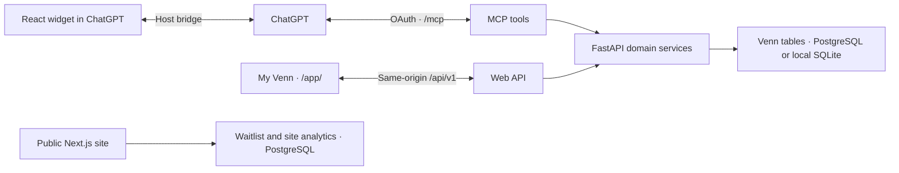

# Venn architecture

Venn helps people maintain existing relationships using memories they approve. ChatGPT and My Venn share an identity and a service layer so a memory approved in chat can explain a match in a later web search. The public site handles discovery and waitlist signups separately.



The root container serves the widget resource, the web build and both application protocols. The public site can share a PostgreSQL instance with the backend. Its waitlist referrals confer no Venn account or connection.

## Components

| Path | What |
| --- | --- |
| `plugin/` | Portable plugin package: `plugin.json`, `mcp.json`, `skills/venn-social/SKILL.md`, assets |
| `.agents/plugins/marketplace.json` | Repo-local marketplace for installing the plugin during development |
| `backend/app/main.py` | `create_app()` — FastAPI app, mounts the MCP Starlette app, health checks, invite landing page (`/i/{code}`), lifespan |
| `backend/app/invite_page.py` | The static page behind an invite link / QR code |
| `backend/app/branding.py` | Shared look (mark, CSS, page shell) of the server-rendered pages: invite page and dev sign-in. No scripts or external requests |
| `backend/app/mcp/server.py` | Builds `MCPServer` with the `Apps` extension, widget resource and auth |
| `backend/app/mcp/tools.py` | MCP tool registrations (thin: auth → service → result) |
| `backend/app/web/` | The website's side of the same backend: `session.py` (dev session cookie), `api.py` (`/api/v1` routes calling the same services as the tools; see `docs/WEB_API.md`), `site.py` (serves `web/dist` at `/app`) |
| `backend/app/question_page.py` | The public page behind a question link (`/q/{token}`) |
| `web/` | React + Vite website for signed-in users; talks only to `/api/v1` on its own origin |
| `backend/app/mcp/common.py` | Scope constants, annotations, `run_as_user`, result/error shaping |
| `backend/app/auth/` | `JWTTokenVerifier` (production), `DevOAuthProvider` (development), identity mapping |
| `backend/app/services/` | Business logic: users, memories (+ search), social (invites/connections/blocking), people (notes on friends not on Venn, import review), relationship (friend view, activity ideas, reconnection, "who do I know who…" search, group plans, meetup brief/recap, follow-ups), quiz, dashboard (home, set-up steps, help), analytics, consent |
| `backend/scripts/seed_demo.py` | `make seed me=<dev username>` — demo friends for a development account |
| `backend/app/ai/extraction.py` | Memory candidate extraction (OpenAI structured output, heuristic fallback) and sensitive-data filter |
| `backend/app/models/` | SQLAlchemy 2 models; `backend/migrations/` Alembic |
| `widget/` | React + Vite single-file bundle rendered by ChatGPT (memory review, home with set-up checklist, help, invite, friend, activity ideas, reconnect, people import, people search, group plan, meetup brief, quiz) |

## One account, two interfaces

ChatGPT (MCP tools) and the website (`/api/v1`) are two front ends over the same services and the same `users`
row. A tool call resolves the user from the OAuth token; a website request resolves it from the session cookie
(development) or a bearer token from the same IdP (production). In development both map to `dev|<username>`, so
the username is the link. Development sign-in requires explicit account creation for a new username. External tokens can provision
the corresponding account on first use. The web API accepts bearer tokens in JWT mode, but the React app
only provides the built-in development sign-in flow. ChatGPT history is never synchronized as a feed.
Text or candidates supplied to a proposal tool reach the backend before the user approves profile memories.

## Request flow

1. ChatGPT calls `POST /mcp` with `Authorization: Bearer <token>`. The SDK's auth middleware
   verifies the token (JWT/JWKS in production, dev provider in development), checks the
   required scopes and the audience/resource, and stores the `AccessToken` in a contextvar.
2. The tool handler calls `run_as_user(scopes, fn)`: it re-checks the tool's scopes, maps the
   token to a user (`auth_subject = "<issuer>|<sub>"`, created on first use), opens a DB
   transaction and runs the synchronous service function in a worker thread.
3. The service enforces ownership on every row it touches. Domain errors become
   `isError` tool results with text `CODE: message`.
4. Results contain short text for the model plus `structuredContent` for the widget.

User ids are **never** taken from tool arguments.

## Widget (MCP Apps)

- One HTML resource `ui://venn/app-v2.html` (`text/html;profile=mcp-app`), built from
  `widget/` into a single file and served from `widget/dist/index.html` (fallback page if missing).
- Card-producing tools bind this resource and return a `view` discriminator. For example,
  `venn_propose_memories` opens a review and `venn_show_reply` opens a reply card.
  The [widget guide](../widget/README.md) maps views to tools and describes the mock bridge
  used by the standalone `/widget-preview` route.
- The widget calls tools back through the host bridge — both data tools (save/edit/delete
  memories, edit profile, add/edit/delete people, confirm an import, respond to requests, log a
  hangout, add or tick off a follow-up, revoke an invite) and other render tools to move between cards — so the same auth applies. Data tools
  the widget may call are marked `openai/widgetAccessible`.
- The invite QR code is generated on the server (`segno`) and sent as rows of `0`/`1`, so the
  widget needs no QR library. "Add to calendar" builds a Google Calendar link in the widget and
  opens it through the host. Separately, users can link Google Calendar through the backend.
  The provider requests free/busy and event permissions. Availability settings and calendar
  connection tools exist today. Meeting proposals, booking and notifications are on the [task board](tasks/README.md).
- Bump the resource URI (`app-v3`) when shipping breaking widget changes; ChatGPT caches templates.

## Memory consent flow

In ChatGPT, the model proposes candidates and the user reviews their wording and visibility.
In My Venn, someone writing a memory by hand approves it by pressing Save. That web-only
path creates the record directly. Both paths associate the saved memory with its owner.

```
user text / model candidates ──▶ venn_propose_memories ──▶ MemoryProposal (server-side, 24h, owner-only)
                                                              │  draft stored, no profile memory
                     user reviews in widget or chat ◀─────────┘
                                   │ approvals [{index, visibility, edits}]
                                   ▼
                          venn_save_memories ──▶ Memory rows (default PRIVATE), proposal consumed
```

### Import from ChatGPT memory

The server has no access to ChatGPT's memory, so extraction and the first review happen in the
chat and only what the user picked is sent:

```
venn_import_chatgpt_memory ──▶ chooser card (areas)          no data in, nothing saved
        │ "Preview my ChatGPT memory" → ui/message into the chat
        ▼
ChatGPT lists what it remembers, in the chat                    Venn sees nothing
        │ user: "keep all except 3 and 7"
        ▼
venn_propose_memories(source="chatgpt_memory", ≤30) ──▶ review card ──▶ venn_save_memories
                                                                          Memory.source = chatgpt_memory
```

It depends on the user having ChatGPT's Memory / chat-history reference switched on and on
ChatGPT using it in a chat where the plugin is active; ChatGPT recalls what it finds relevant,
not a complete export of every past chat.

The review interface collects the user’s selection. The backend validates the submitted selection: saving requires a server-issued `proposal_id` owned by the
caller, only indexes from that proposal are accepted, and each proposal can be used once.

## Connections

Invite codes (`XXXX-XXXX`, 72h, limited uses, revocable) → redeeming sends a connection request
→ the inviter accepts/declines → a canonical `connections` row (`user_a_id < user_b_id`).
A private person note belongs to its author. For an accepted connection, relationship views
use the memories that friend chose to share. Blocking excludes the person in both directions.
Venn can draft an invitation for the user to send.

The weekly review follows the same proposal and visibility rules as other memories.
The public walkthrough illustrates what a friend might learn from a shared update.
The shipped backend exposes shared records when queried. Proactive delivery and
automatic booking are separate work items in the [scheduling roadmap](tasks/SCHEDULING.md).

## Auth modes

- `AUTH_MODE=jwt` (required in production): ChatGPT does OAuth with your IdP (Auth0, Clerk,
  Supabase Auth, ...). The server is only a resource server: it publishes protected-resource
  metadata pointing at `OAUTH_ISSUER` and validates RS/ES/PS-signed JWTs from `OAUTH_JWKS_URL`
  (`iss`, `aud`, `exp`, signature, scopes).
- `AUTH_MODE=dev`: a built-in OAuth authorization server (dynamic client registration, PKCE,
  a simple username sign-in page, HS256 tokens). Refused when `ENVIRONMENT=production`.

## Deployment

`Dockerfile` builds the widget and web app, packages both with the backend, and runs `alembic upgrade head` before
`uvicorn app.main:create_app --factory`. Behind a TLS-terminating proxy, set `PUBLIC_BASE_URL`
to the public https URL and add the host to `ALLOWED_HOSTS` if it differs. The MCP endpoint is
stateless (`stateless_http=True`, JSON responses), while durable product state lives in the database.
